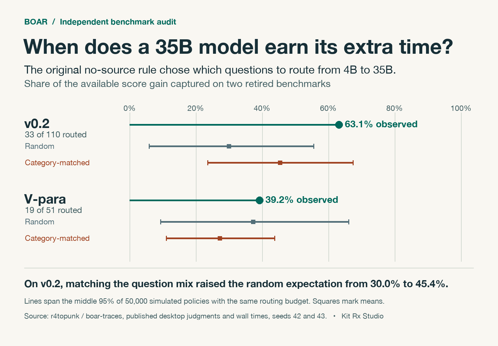

# When should BOAR spend a question on the larger model?

The BOAR research record describes routing individual questions from its 4B model to its 35B model as “chance-level out of sample.” The team’s R2 rule asks the larger model to answer when the 4B system reports no acceptable source. On one of its two retired evaluation sets, R2 sent **33 of 110 questions** to the 35B model and captured **63.1% of the larger model’s score gain**. A lottery sending the same number of questions captured 30.0% on average. On the other set, the rule and the lottery performed almost identically. These are desktop results for the 35B model with thinking disabled. [Research summary](https://github.com/r4topunk/boar-research/blob/6b7caca9bd932d69859d0cc10f97fd9aecff4ce9/README.md#results-at-a-glance-what-each-lever-was-worth)



| Benchmark | Sent to 35B | Always 4B | R2 routing | Always 35B | Share of score gain captured | Random routing at the same estimated mean time |
|---|---:|---:|---:|---:|---:|---:|
| v0.2 | 33/110 | 0.5124 | **0.5471** | 0.5675 | **63.1%** | 0.5291 |
| V-para | 19/51 | 0.4133 | **0.4344** | 0.4670 | **39.2%** | 0.4307 |

The scores are the project’s raw ratios of summed rubric points. For v0.2, routing improved the score by 0.0348 out of an available 0.0551. Selecting the corresponding recorded arm timings gave estimated means of 8.53 seconds for always-4B, 15.65 seconds for R2 and 31.97 seconds for always-35B. This replay assumes the source-availability signal is available before model dispatch. Loading, switching and live phone memory costs would need measurement on the intended hardware. [Full numerical output](results.json)

## What changed the interpretation

The authors’ original routing analysis defined R2 from the existing 4B route log. The October 8 out-of-sample check could measure whether a question was hard for 4B before it could measure whether 35B helped on that question. Their later work measured R2 on V-para. The subsequent v0.2 SMALLROUTE deep-tier comparison used retained-source counts and a post-generation on-topic label as proxies. The later public traces allow a direct test of the original R2 flag on all 110 v0.2 questions. This audit uses the published signal and pairs outcomes from the same questions, answer orders and generation seeds. [R2 implementation](https://github.com/r4topunk/boar-research/blob/6b7caca9bd932d69859d0cc10f97fd9aecff4ce9/rnd/research/coordinator/arms/deeproute/r2oos.py) · [Original out-of-sample analysis](https://github.com/r4topunk/boar-research/blob/6b7caca9bd932d69859d0cc10f97fd9aecff4ce9/rnd/research/coordinator/arms/deeproute/DEEPROUTE-OOS.md) · [Closed families 28 and 98](https://github.com/r4topunk/boar-research/blob/6b7caca9bd932d69859d0cc10f97fd9aecff4ce9/rnd/research/coordinator/CLOSED.md) · [SMALLROUTE comparison](https://github.com/r4topunk/boar-research/blob/6b7caca9bd932d69859d0cc10f97fd9aecff4ce9/rnd/research/coordinator/arms/smallroute/S0.md)

**Question mix explains part of the v0.2 advantage.** Of the 33 selected questions, 12 were categorized as reasoning. There were 21 reasoning questions in the full 110. A random router required to select the same number from *each* category averaged 0.5374, equivalent to 45.4% of the available gain. The original rule’s remaining advantage was 0.0098. In 50,000 matched lotteries, the one-sided permutation probability was **0.0570**, compared with **0.0058** for a lottery constrained only by the total. For V-para the corresponding probabilities were **0.0806** and **0.4437**. These probabilities describe finite-benchmark comparisons. They do not establish that retrieval failure itself causes a larger model to help. [Numerical output](results.json)

Two sensitivity checks kept the same 33 v0.2 questions and changed the larger model’s thinking budget. R2 captured **47.5%** of the gain with budget 512 (seed 42) and **52.6%** with budget 1024 (seeds 42 and 43). The uniform-lottery probabilities were 0.0363 and 0.0037. The category-matched probabilities rose to 0.2320 and 0.0978. These comparisons reuse the same questions and judge family. [Numerical output](results.json)

**What this supports.** On v0.2 there was a useful concentration of additional desktop-model quality at a fixed routing budget. Its strength depended on the benchmark and the question mix. Both sets are retired development data, this analysis was retrospective, and multiple configurations were examined. The published 70%-of-gain target at no more than 40% routed remains unmet. The appropriate next test is to freeze R2 and a category-matched baseline, define the intended query mix, and compare both at equal measured device latency on new questions. This analysis makes no change to the phone’s original score or the project’s bounty verdict. [The authors’ routing criterion](https://github.com/r4topunk/boar-research/blob/6b7caca9bd932d69859d0cc10f97fd9aecff4ce9/rnd/research/coordinator/arms/deeproute/DEEPROUTE.md) · [Dataset status](https://github.com/r4topunk/boar-research/blob/6b7caca9bd932d69859d0cc10f97fd9aecff4ce9/README.md#status-final)

## Reproduce

Run with Python 3.10 or later. The standard-library script downloads public, checksum-verified JSONL files. The optional cache allows later runs without downloading again.

```sh
python3 audit.py --cache .audit-cache > reproduced.json
diff -u results.json reproduced.json
```

1. Join the 4B cut-6 and 35B runs on question ID. Require the same frozen reference hash, judge version, judge model, category and full question set, with both A/B orders on each seed. Sum correctness, completeness and usefulness for the assistant and reference. Each question receives equal weight before forming the ratio of total points.
2. Route when the 4B trace contains either published R2 reason code, `grounding:no-good-source` or `grounding:no-source-memory`. The flags agree across seeds 42 and 43 on every item in both primary comparisons. R2 was selected by the original team on a different, earlier development benchmark. The choice to audit the subsequently available arms was retrospective.
3. Form each hybrid score from the selected arm’s numerator **and** denominator. Compute gain capture as (hybrid − 4B) / (35B − 4B). For the time-matched baseline, solve for the random routing fraction that matches the hybrid’s mean recorded time, then form the ratio of the expected score totals.
4. Draw fixed-size random subsets with Python’s random seed 1520. The second lottery also preserves the selected count within each published question category. Compare the observed score to each simulated score and apply the plus-one correction. The chart intervals are the central 95% of simulated policies on these fixed questions.

The original experiments, data and R2 rule are by **r4topunk and the BOAR/LabRat project**. The independent computation, chart and interpretation are by **Kit Rx Studio**, with AI assistance for analysis, coding and drafting. As of November 27, 2026, the sponsor’s public listing returned 62 claims. In their public summaries, claims 9234 and 9838 separately discuss the 35B model’s potential. We found no earlier claim reporting this exact paired v0.2 routing result. [Research record](https://github.com/r4topunk/boar-research/tree/6b7caca9bd932d69859d0cc10f97fd9aecff4ce9) · [Benchmark and judge](https://github.com/r4topunk/boar-bench/tree/b41a25acfabf89f1d015103ca1329554f985a257) · [Pinned public traces](https://huggingface.co/datasets/r4topunk/boar-traces/tree/f96e277cf8584b38c35c01106c1fe77457dfaa81) · [Bounty and existing claims](https://poidh.xyz/base/bounty/1520)
